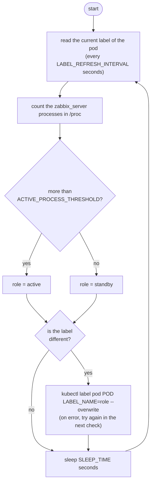
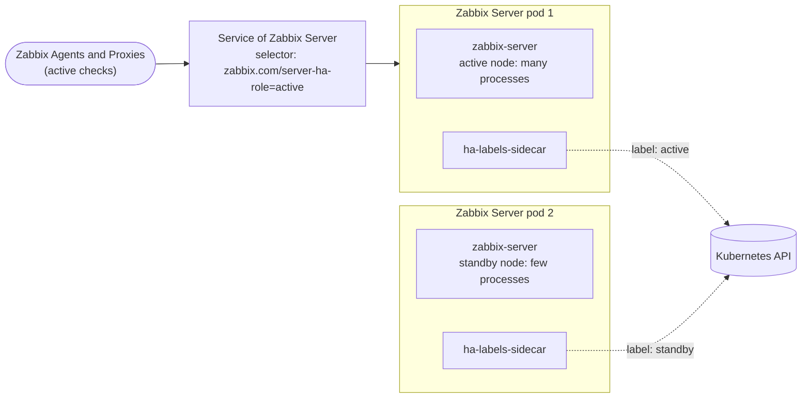
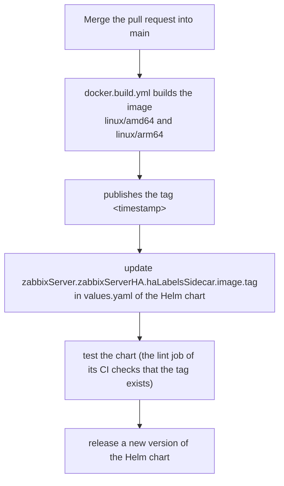

# Zabbix Server HA labels sidecar

[](https://opensource.org/licenses/Apache-2.0)

<!-- TOC -->

- [Zabbix Server HA labels sidecar](#zabbix-server-ha-labels-sidecar)
  - [About](#about)
  - [How it works](#how-it-works)
  - [Image](#image)
  - [Environment variables](#environment-variables)
  - [Kubernetes requirements](#kubernetes-requirements)
  - [Development and local tests](#development-and-local-tests)
  - [Repository structure](#repository-structure)
  - [Release process](#release-process)
  - [Contributing](#contributing)
  - [Maintainers](#maintainers)
  - [License](#license)

<!-- TOC -->

## About

This repository builds the image ``ghcr.io/zabbix-community/zabbix-server-ha-label-manager``, a sidecar of the Zabbix Server pods of the [Zabbix Helm chart](https://github.com/zabbix-community/helm-zabbix) when Zabbix Server High Availability is enabled (``zabbixServer.zabbixServerHA.enabled=true``).

With Zabbix Server HA, only one Zabbix Server is active; the others are standby nodes. Zabbix Agents with active checks and active Zabbix Proxies must connect to the active node. The sidecar sets the label ``zabbix.com/server-ha-role`` of its pod to ``active`` or ``standby``, and the Service of Zabbix Server selects only the ``active`` pod.

Probing the port of Zabbix Server would also find the active node, but each probe without a proper payload generates a message in the log of Zabbix Server. See [zabbix-community/helm-zabbix#115](https://github.com/zabbix-community/helm-zabbix/issues/115).

## How it works

The Zabbix Server pods share their process namespace (``shareProcessNamespace: true``), so the sidecar sees the processes of the ``zabbix-server`` container. The active node runs all the Zabbix processes (pollers, trappers, history syncers, ...), while a standby node runs only the main process, the HA manager and a few others. Every ``SLEEP_TIME`` seconds, the sidecar counts the processes whose command line contains ``zabbix_server``:





When the active node fails, a standby node starts all the processes, its sidecar changes the label to ``active`` and the Service sends the connections to it. The sidecar stops immediately on ``SIGTERM``, so it doesn't delay the termination of the pod.

## Image

- Base image: ``alpine`` with the ``kubectl`` package. Dependabot updates the tag of the base image, which also defines the version of ``kubectl``.
- User: ``1001``.
- Platforms: ``linux/amd64`` and ``linux/arm64``.
- Tags: ``<UTC timestamp>``, e.g. ``20261107120000``. The chart uses ``zabbixServer.zabbixServerHA.haLabelsSidecar.image.tag``.

## Environment variables

| Variable | Default | Description |
|---|---|---|
| ``LABEL_NAME`` | (required) | Label set on the pod. The chart sets ``zabbixServer.zabbixServerHA.haLabelsSidecar.labelName`` (``zabbix.com/server-ha-role``) |
| ``POD_NAME`` | the hostname | Name of the pod. The hostname of a pod is its name by default |
| ``ACTIVE_PROCESS_THRESHOLD`` | ``5`` | The node is active with more ``zabbix_server`` processes than this number |
| ``SLEEP_TIME`` | ``5`` | Seconds between checks |
| ``LABEL_REFRESH_INTERVAL`` | ``300`` | Seconds between reads of the current label from the Kubernetes API |

## Kubernetes requirements

- The pod must share the process namespace: ``shareProcessNamespace: true``.
- The service account of the pod needs ``get`` and ``patch`` on ``pods`` in its namespace. The chart creates the Role and RoleBinding ``<fullname>-ha-helper`` for the service account of the Zabbix Server pods.

## Development and local tests

Install the [requirements](docs/requirements.md) and run ``make help`` to list the targets:

```bash
make check-os
make install-deps
make check-deps

make lint        # shellcheck and hadolint
make build       # builds zabbix-server-ha-label-manager:local
make kind-test   # end-to-end test in a kind cluster
```

See the [local tests](docs/local-tests.md), including the test with the Helm chart.

## Repository structure

```text
.
├── .github
│   ├── ISSUE_TEMPLATE
│   │   ├── bug_report.md
│   │   └── feature_request.md
│   ├── workflows
│   │   ├── docker.build.yml        # Builds and publishes the image on push to main
│   │   └── tests.yaml              # Lints and tests the image in kind on pull requests
│   ├── CODEOWNERS
│   ├── dependabot.yml              # Updates the GitHub Actions and the base image
│   └── PULL_REQUEST_TEMPLATE.md
├── docs
│   ├── local-tests.md              # How to test the image locally, in kind and with the Helm chart
│   └── requirements.md             # Requirements to develop and test the image
├── tests
│   ├── kind-test.sh                # End-to-end test in a kind cluster (make kind-test)
│   └── kind-test.yaml              # Pod with a fake Zabbix Server and the sidecar, used by kind-test.sh
├── CLAUDE.md                       # Guidance for Claude Code when working in this repository
├── CONTRIBUTING.md                 # How to contribute and how to publish new images
├── Dockerfile
├── ha-label-manager.sh             # The sidecar script
├── LICENSE
├── Makefile                        # Targets to check/install requirements, lint, build and test
├── mise.toml                       # Versions of the development tools, installed via mise
└── README.md                       # This file
```

## Release process

There are no releases or git tags: each push to ``main`` that changes the image publishes a new tag. Publishing is restricted to the maintainers (see [CONTRIBUTING.md](CONTRIBUTING.md#for-code-maintainers-only)).



## Contributing

See the [CONTRIBUTING.md](CONTRIBUTING.md) file.

## Maintainers

- [Aecio dos Santos Pires](https://www.linkedin.com/in/aeciopires/)
- [Christian Anton](https://www.linkedin.com/in/christiananton1/)

## License

[Apache 2.0 License](LICENSE).
