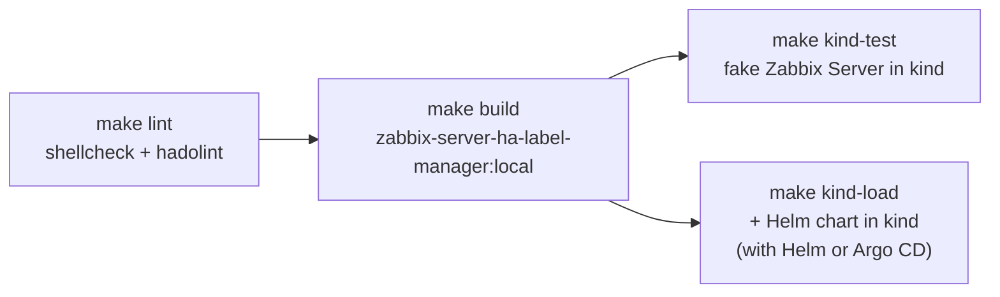

<!-- TOC -->

- [Local tests](#local-tests)
- [Lint](#lint)
- [Build](#build)
- [End-to-end test in kind](#end-to-end-test-in-kind)
- [Tests with the Helm chart](#tests-with-the-helm-chart)

<!-- TOC -->

# Local tests

Install the [requirements](requirements.md). Run the commands in the root directory of this repository. Run ``make help`` to list all targets.



# Lint

```bash
make lint
```

# Build

```bash
make build
```

The tag is ``zabbix-server-ha-label-manager:local``. Change it with ``IMAGE_TAG``.

# End-to-end test in kind

```bash
make kind-test
```

The [tests/kind-test.sh](../tests/kind-test.sh) script creates the kind cluster ``KIND_CLUSTER_NAME`` (default: ``helm-zabbix-image-ha-labels-sidecar``) if it doesn't exist, loads the image and creates the resources of [tests/kind-test.yaml](../tests/kind-test.yaml) in the ``ha-labels-sidecar-test`` namespace: a pod with ``shareProcessNamespace: true``, the sidecar and a fake Zabbix Server container, which runs 3 processes whose command line contains ``zabbix_server``, then 8, then 3 again. The test checks that:

1. the label ``zabbix.com/server-ha-role`` of the pod is ``standby``;
2. then ``active``;
3. then ``standby`` again;
4. the pod stops in less than 15 seconds when it is deleted (the sidecar handles ``SIGTERM``).

The namespace is deleted at the end. To use the kind cluster of the Helm chart, run ``make kind-test KIND_CLUSTER_NAME=helm-zabbix``. Delete the cluster of the test with:

```bash
make kind-delete
```

# Tests with the Helm chart

Test the image with the real Zabbix Server pods of the [Zabbix Helm chart](https://github.com/zabbix-community/helm-zabbix) with HA enabled:

```bash
# In the clone of this repository
make build

# In the charts/zabbix directory of the clone of helm-zabbix
make kind-create
make kind-load IMAGES="zabbix-server-ha-label-manager:local"
make external-db-create
helm upgrade --install zabbix . -n monitoring --wait \
  -f docs/example/kind/values-ha.yaml -f docs/example/ha/values-local-images.yaml

kubectl get pods -n monitoring -l app.kubernetes.io/component=server -L zabbix.com/server-ha-role
```

The ``values-local-images.yaml`` file of the chart also uses the local image of the database job. Build it in the clone of [helm-zabbix-image-db-init-upgrade-job](https://github.com/zabbix-community/helm-zabbix-image-db-init-upgrade-job) or remove the ``dbCreateUpgradeJob`` part of the file.

See the [HA tutorial of the chart](https://github.com/zabbix-community/helm-zabbix/blob/main/charts/zabbix/docs/example/ha/README.md) for the test scenarios (failover, transition from a standalone Zabbix Server to HA, upgrades), with Helm and with Argo CD.
